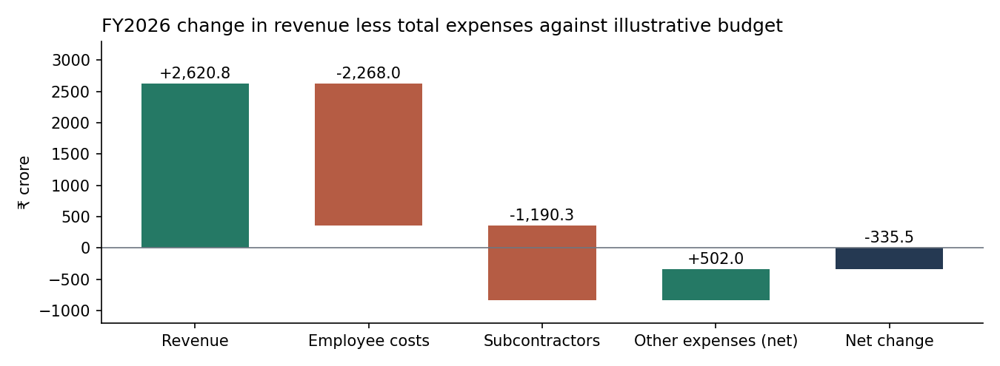

# Infosys FY2026 budget variance review

Revenue exceeded the illustrative budget by ₹2,620.80 crore. Total expenses exceeded it by ₹2,956.28 crore. Together these movements reduced **revenue less total expenses by ₹335.48 crore** against plan. This subtotal includes finance cost. Other income, exceptional expense and taxes sit outside this comparison.

## Management review

| FY2026 measure (₹ crore) | Illustrative budget | Reported actual | Actual less budget |
|---|---:|---:|---:|
| Revenue | 176,029.20 | 178,650.00 | +2,620.80 |
| Employee costs | 92,826.00 | 95,094.00 | +2,268.00 |
| Subcontractors | 14,230.70 | 15,421.00 | +1,190.30 |
| Remaining expenses within total expenses | 31,675.02 | 31,173.00 | −502.02 |
| Total expenses | 138,731.72 | 141,688.00 | +2,956.28 |
| Revenue less total expenses | 37,297.48 | 36,962.00 | −335.48 |

Subcontractors had the larger percentage overrun of the two named cost lines (8.36%). Employee costs had the larger rupee overrun (₹2,268 crore). A manager investigating the gap could request headcount and compensation movements for employees, and billed hours and rates for contractors. The annual totals alone cannot distinguish rate changes from volume changes.

## Reproduce the result in Excel

1. Open [the comparison data](data/comparisons.csv) in Excel. Copy Metric, Budget and Actual into a blank sheet. Start with revenue, employee costs, subcontractors and total expenses.
2. In D2 enter `=C2-B2`. In E2 enter `=IF(B2=0,"N/A",D2/B2)`. Fill down and format numeric percentages to two decimals. A positive cost variance represents additional spending.
3. Calculate remaining expenses as total expenses less employee costs and subcontractors in each column. This residual already belongs to total expenses. Check that all three expense components sum back to the reported total.
4. Subtract total expenses from revenue in each column. Check that the actual subtotal minus the budget subtotal equals the signed sum of the chart movements.
5. As a sensitivity exercise, hold everything else constant and reduce actual subcontractor cost by ₹100 crore. Calculate the revised total expenses and subtotal. The adverse gap narrows to ₹235.48 crore.

## Month-end practice

Assume a contractor delivers services worth ₹50,000 in March and invoices in April. At March close, debit contractor expense and credit accrued expenses by ₹50,000. When the invoice is recorded in April, debit accrued expenses and credit accounts payable, assuming the invoice equals the accrual and no reversal has been posted. Omitting the March accrual understates March expenses and overstates March profit. This fictional exercise uses rupees and is separate from the Infosys figures.

## Files and provenance

- [Excel model](Infosys_Budget_Three_Statements.xlsx) — original guided three-statement workbook and planning assumptions.
- [Comparison data](data/comparisons.csv) — model output used in the review. A zero budget makes percentage variance undefined.
- [Source extract](data/source.json) — consolidated Ind AS figures and original filing reference. [Infosys filing on SEC EDGAR](https://www.sec.gov/Archives/edgar/data/1067491/000106749126000018/exv99w10.htm).

AI-assisted educational portfolio case study. The budget was constructed for this exercise. Infosys did not supply an internal plan. The analysis uses annual historical results.
